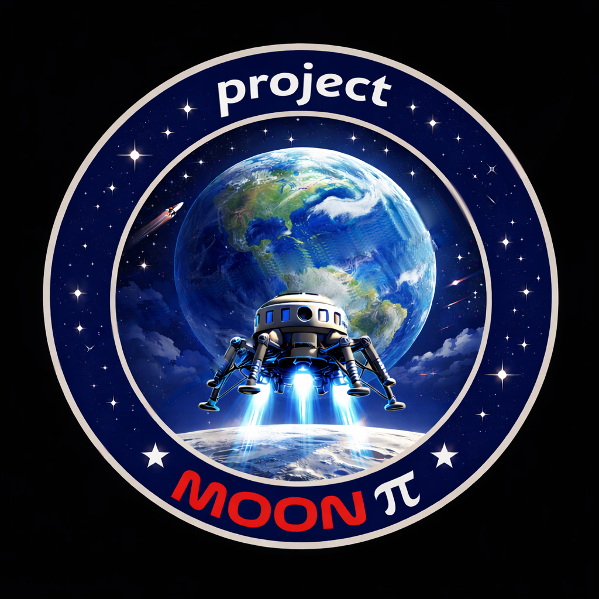
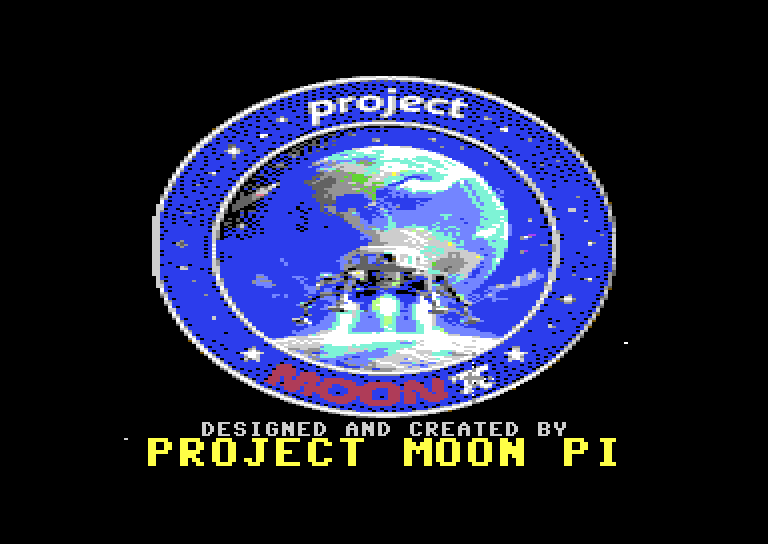

<b>Designed and Created by Project Moon Pi</b>

# Project Moon Pi Commodore projects

New software and hardware for the **Commodore 64 and 128**. Everything is written for **NTSC** machines.

Each project has its own repository with source, build notes and ready-to-run downloads. This page lists them
all. You can also browse the [`commodore-64` topic](https://github.com/topics/commodore-64?q=user%3Aprojectmoonpi).

## Projects

### [Project Moon Pi intro](https://github.com/projectmoonpi/c64-moonpi-intro)

The animated Project Moon Pi logo intro, built to push the C64:
- a starfield and a sprite coin fly-in;
- the badge as an FLI picture, with new colours on every raster line;
- a flare that runs round the ring while sprites move over the FLI picture;
- a three-voice SID score.

**Downloads:** [disk (.d64), program (.prg) and cartridge (.crt)](https://github.com/projectmoonpi/c64-moonpi-intro/releases/latest)

**Machine:** NTSC C64

**Status:** 1.0.0, tested in VICE; real hardware next.

## Coming up

- User-port and cartridge-port hardware for the C64 (and maybe the C128).

## Tools

The projects are built on a Mac with:
- the [ACME](https://sourceforge.net/projects/acme-crossass/) cross-assembler;
- [Exomizer](https://bitbucket.org/magli143/exomizer/wiki/Home);
- [VICE](https://vice-emu.sourceforge.io/) for testing;
- [OpenCBM](https://github.com/OpenCBM/OpenCBM) for writing real disks.

## Credits

- Project Moon Pi logo and designs: Project Moon Pi.
- Tools: ACME (Marco Baye and contributors), Exomizer (Magnus Lind), VICE (the VICE team), OpenCBM (the
  OpenCBM team). Each project's own README lists its full credits.
- Commodore 64 and Commodore 128 are trademarks of their respective owners. Project Moon Pi is not affiliated with
  them.
- Built with Claude Code (Anthropic).
